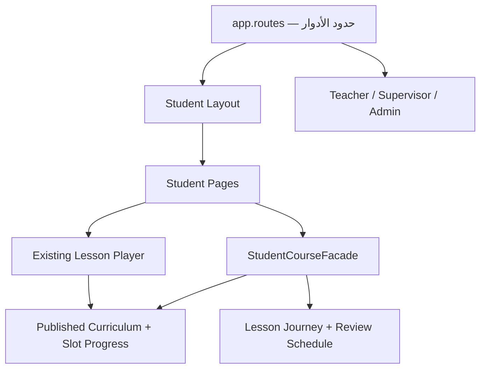

# بحث وتسليم هندسي — تجربة الطالب في Shadowing English

**التاريخ:** 10 سبتمبر 2026  
**النطاق المنفذ:** واجهة الطالب فقط، مع الحفاظ على حدود مستقلة للأدوار المستقبلية: طالب، مدرس، مشرف، أدمن.

## الملخص التنفيذي

تم تحويل واجهة الطالب من Dashboard مزدحمة تعرض أسابيع وأيام وإحصاءات كثيرة إلى مسار تعلم موجّه:

> تسجيل الدخول ← مساري ← الأسبوع ← الدرس ← الشادوينج ← الكلمات والجمل ← الاستماع الكامل ← مراجعة سريعة ← إكمال ← مراجعات شادوينج يومية.

الطالب لا ينشئ منهجًا أو درسًا ولا يعيد ترتيبه. يرى النسخة المنشورة لمجموعته فقط، ويظهر له فعل أساسي واحد في كل شاشة. تم الاحتفاظ ببنية المنهج الإدارية الحالية `Week → Day → Slot` في البيانات، بينما يتم إخفاء `Day` من تجربة الطالب وعرض `Week → Lesson → Stage`؛ وبذلك لا نكسر أدوات الإدارة الحالية ولا نضيف طبقة ذهنية غير ضرورية للطالب.

## ما قاد قرارات التصميم

1. توصي إرشادات Angular بتنظيم المشروع حسب مناطق الوظائف، وإبقاء الـcomponents مركزة على العرض، ونقل المنطق المعقد إلى TypeScript وخدمات واضحة. لذلك وضعت الرحلة وقواعدها داخل `features/student/data-access` بدل توزيعها بين الصفحات. [Angular Style Guide](https://angular.dev/style-guide)
2. يدعم Angular تحميل المكونات والمسارات عند الحاجة باستخدام `loadComponent` و`loadChildren`. تم تطبيق ذلك على حدود الأدوار وصفحات الطالب حتى لا تُحمّل أدوات الأدمن والمشرف مع شاشة الطالب الأولى. [Angular Route Loading Strategies](https://angular.dev/guide/routing/loading-strategies)
3. تمت إضافة عنوان لكل Route لأن عنوان الصفحة الواضح جزء من قابلية الاستخدام والوصول. [Angular — Define Routes](https://angular.dev/guide/routing/define-routes)
4. فكرة «إظهار الخطوة الصحيحة التالية» مستلهمة من شرح Duolingo لمسار التعلم الموجّه، مع الحفاظ على التقدم وإدخال المراجعة المتباعدة داخل المسار. هذا مبدأ تجربة مستخدم، وليس نسخًا لواجهة Duolingo. [Duolingo Path](https://blog.duolingo.com/new-duolingo-home-screen-design/)
5. جدولة المراجعات بعد 1 و3 و7 و14 يومًا مبنية على مبدأ الممارسة المتباعدة والاسترجاع النشط؛ الفواصل نفسها إعداد منتج قابل للتغيير لاحقًا وليست رقمًا تربويًا ثابتًا. [AERO — Spacing and Retrieval Practice](https://www.edresearch.edu.au/guides-resources/practice-guides/spacing-and-retrieval-practice-guide-full-publication)
6. وضعت تسميات فعلية للحقول، ورسائل حالة قابلة للقراءة، وأهداف تفاعل كبيرة. هذا يتماشى مع إرشادات W3C للـlabels ومعيار WCAG 2.2 لأهداف اللمس ورسائل الحالة. [W3C Form Labels](https://www.w3.org/WAI/tutorials/forms/labels/) و[WCAG 2.2](https://www.w3.org/TR/WCAG22/)

## معمارية المشروع بعد التنفيذ



### حدود الأدوار

| الدور | مسؤوليته | الوضع الحالي |
|---|---|---|
| الطالب | تنفيذ المسار ومراجعة ما أتمه | تم تطبيق الرحلة الجديدة |
| المدرس | إعداد الدروس والمنهج والتعامل التعليمي | Feature موجود؛ صلاحياته النهائية مؤجلة |
| المشرف | متابعة الطلاب والتقارير والرسائل | موجود ولم يتم تغيير سلوكه |
| الأدمن | إدارة المنصة والحسابات والإعدادات | موجود ولم يتم تغيير سلوكه |

كل دور له Layout وRoute boundary وFeature directory مستقل. لا توجد صفحات أدوار داخل مجلد عالمي واحد. حراس Angular يمنعون التنقل في الواجهة، لكن يجب أن يكرر Backend كل فحص صلاحية؛ Angular نفسه يحذر من الاعتماد على حراس العميل وحدهم. [Angular Route Guards](https://angular.dev/guide/routing/route-guards)

### ملفات رحلة الطالب الجديدة

```text
features/student/
├── data-access/
│   ├── student-learning.models.ts
│   ├── student-learning.repository.ts
│   ├── student-lesson-content.service.ts
│   └── student-course.facade.ts
├── pages/
│   ├── dashboard/
│   ├── weeks/
│   ├── week/
│   ├── lesson-overview/
│   ├── lesson-player/          # المحرك الحالي محفوظ
│   ├── lesson-stage/
│   ├── lesson-complete/
│   ├── review/
│   └── progress/
└── student.routes.ts
```

## Routes الطالب

| Route | الغرض |
|---|---|
| `/auth/login` | دخول واضح، وحساب الطالب هو الافتراضي في العرض |
| `/student/dashboard` | فعل اليوم والأسبوع الحالي ومراجعة اليوم |
| `/student/weeks` | كل الأسابيع وحالتها |
| `/student/weeks/:weekId` | دروس الأسبوع بالترتيب |
| `/student/lessons/:lessonId` | نظرة الدرس ومراحله |
| `/student/lessons/:lessonId/shadowing` | المحرك الحالي للتسجيل والترديد |
| `/student/lessons/:lessonId/vocabulary` | الكلمات والجمل |
| `/student/lessons/:lessonId/listen` | الاستماع الكامل |
| `/student/lessons/:lessonId/quiz` | مراجعة سريعة |
| `/student/lessons/:lessonId/complete` | النتيجة وما سيفتح بعدها |
| `/student/review` | مراجعات الشادوينج المستحقة |
| `/student/progress` | تقدم مختصر حسب الأسبوع |

تم الإبقاء على `/student/lesson/:lessonId` كمسار توافق قديم حتى لا تنكسر روابط محفوظة.

## نموذج التقدم

هناك مصدران متكاملان، ولا يجب دمجهما عشوائيًا:

1. **`StudentProgress` الحالي:** مصدر حقيقة تكرارات الشادوينج والتسجيلات، ومربوط بالطالب والمجموعة والدرس و`curriculumSlotId`.
2. **`StudentLessonJourney` الجديد:** حالة مراحل الدرس الأربع ونتيجة المراجعة السريعة ووقت الإكمال.

هوية التقدم هي:

```text
studentId + groupId + curriculumSlotId
```

وليست `lessonId` فقط؛ لأن الدرس نفسه قد يظهر أكثر من مرة في المنهج أو يتغير موضعه، بينما الـSlot يمثل التكليف الدقيق المنشور للطالب.

## خوارزمية فتح الدروس

1. قراءة آخر Snapshot منشور لمجموعة الطالب.
2. ترتيب الأسابيع حسب `week.order`.
3. ترتيب الأيام داخليًا حسب `day.order`، ثم Flatten للدروس دون عرض اليوم للطالب.
4. ترتيب الـSlots حسب `slot.order`.
5. أول درس إجباري غير مكتمل هو الفعل الحالي.
6. الدرس التالي لا يفتح حتى يكتمل الدرس الإجباري السابق.
7. الـSlot الاختياري لا يمنع ما بعده.
8. الدرس المكتمل يظل متاحًا للمراجعة الكاملة أو الشادوينج فقط.

التعقيد الحالي خطي `O(n)` في عدد Slots المنشورة، وهو مناسب لأننا نبني View Model واحدة ثم تعرض الصفحات أجزاء منها. يوجد منع لتكرار تهيئة البيانات خلال نافذة 30 ثانية لتجنب استدعاءات Backend متكررة أثناء انتقال الطالب السريع بين مراحل الدرس.

## خوارزمية مراحل الدرس

الترتيب ثابت في تعريف مركزي واحد:

```text
shadowing → vocabulary → listen → quiz
```

- كل مرحلة تصبح `available/current` بعد اكتمال السابقة.
- اكتمال الشادوينج يُشتق من `completedRepetitions >= requiredRepetitions` ولا يعاد تنفيذه داخل Journey Repository.
- قبل حفظ مرحلة جديدة، ينسخ الـFacade حالة المراحل المكتملة إلى Journey Store بصورة idempotent.
- اكتمال الأربع مراحل ينشئ موعد الإكمال وجدول المراجعات مرة واحدة فقط.
- تعريف المراحل مركزي؛ إضافة مرحلة مستقبلًا لا تحتاج نسخ قواعد جديدة في كل صفحة.

## خوارزمية المراجعة اليومية

عند اكتمال الدرس تُنشأ مراجعات شادوينج عند الفواصل:

```text
D+1, D+3, D+7, D+14
```

كل مراجعة مرتبطة بالـSlot نفسه. شاشة اليوم تعرض المراجعات المستحقة فقط؛ شاشة الإكمال تستطيع فتح Preview لمراجعة الغد دون اعتبارها منجزة. يمكن لاحقًا نقل الفواصل إلى إعداد منهج أو تجربة A/B دون تغيير الصفحات.

## قابلية التوسع

### إضافة أداة داخل الدرس

لإضافة أداة مثل تقييم النطق بالذكاء الاصطناعي:

1. إضافة `StudentStageId` جديد وتعريفه في `STUDENT_STAGE_DEFINITIONS`.
2. إضافة صفحة/Component للأداة أو Adapter مستقل.
3. تسجيل Route lazy.
4. جعل الـBackend يحفظ نتيجة الأداة كبيانات ملحقة، وليس داخل Recording metadata.
5. إضافة اختبار للترتيب، وإعادة المحاولة، واستئناف المرحلة.

### إضافة Backend حقيقي لحالة الرحلة

النسخة الحالية تحفظ حالة المراحل والمراجعات في LocalStorage بمفتاح versioned:

```text
english-shadowing-student-learning-v1
```

هذا مناسب للعرض Frontend-first، لكنه ليس مصدر حقيقة للإنتاج. العقود المقترحة:

```text
GET  /api/students/{studentId}/learning-path
PUT  /api/student-journeys/{slotId}/stages/{stageId}
POST /api/student-reviews/{reviewId}/complete
```

ينبغي أن يستخدم الـBackend optimistic concurrency أو version/ETag عند تعديل Journey، وأن يتحقق من عضوية الطالب في المجموعة ومن أن Snapshot منشور. عند إضافة API، يبقى `StudentCourseFacade` واجهة الصفحات ويتحول Repository إلى Adapter بعيد؛ لذلك لا تتغير Templates.

### التعامل مع تغييرات المنهج

- نشر نسخة جديدة لا يمسح تقدم Slot موجود.
- استبدال `lessonId` داخل Slot يجب أن يبدأ تقدمًا جديدًا لهذا التكليف، كما يفعل Progress Repository الحالي.
- حذف Slot من Snapshot الجديد لا يحذف التسجيلات تاريخيًا؛ يعرض كأرشيف في أدوات الإدارة.
- تغيير `requiredRepetitions` يعيد حساب اكتمال الشادوينج دون تعديل التسجيلات نفسها.

## الوصول والأمان

- كل حقل Login له `<label>` مرتبط بمعرف واضح.
- رسائل الخطأ تستخدم `role="alert"`، ورسائل المساعدة والتحميل تستخدم `role="status"`.
- الأزرار وأهداف التنقل الأساسية أكبر من 44px في معظم الحالات، وتتجاوز حد WCAG الأدنى البالغ 24×24 CSS px. [WCAG Target Size](https://www.w3.org/WAI/WCAG22/#target-size-minimum)
- لا توجد صلاحية إنشاء/حذف/ترتيب منهج داخل Student Feature.
- حراسة الـroutes تحسين UX فقط؛ التفويض النهائي يجب أن يكون في API.
- لا يُرسل التسجيل أو تقدم المراحل لخدمة ذكاء اصطناعي ضمن هذا التنفيذ.

## التحقق المنفذ

- `npm run build`: نجح Production build.
- `npm test -- --watch=false`: نجحت **18/18** اختبارات في **6/6** ملفات.
- تمت إضافة اختبارات لحفظ التقدم بهوية Slot، وidempotency، وجدولة مراجعات 1/3/7/14، وإكمال مراجعة منفردة، واختبار انحدار يثبت انتهاء شاشة التحميل تلقائيًا في وضع Angular Zoneless دون تفاعل يدوي.
- أصبحت صفحات الطالب، الـLesson Player، وصفحات الأدوار الأخرى Lazy chunks منفصلة.
- تعذر أخذ Screenshot آلي داخل بيئة العمل لأن المتصفح الخارجي يمنع عنوان localhost وتنزيل Chromium انتهى بمهلة شبكة؛ لذلك لم يتم الادعاء بإجراء Visual QA آلي. يلزم فتح المشروع محليًا للمراجعة البصرية النهائية.

## معايير قبول الجولة التالية

1. تجربة رحلة كاملة على Chrome وSafari وهاتف فعلي.
2. اختبار الميكروفون والتسجيل بعد الانتقال إلى Route الجديد.
3. اعتماد أسماء المراحل والمحتوى العربي مع المدرس.
4. حسم هل تقييم الاختبار يؤثر على الإكمال أم هو Feedback فقط؛ التنفيذ الحالي يسمح بالإكمال بعد الإجابة.
5. اعتماد فواصل المراجعة من الفريق التعليمي.
6. نقل Journey/Review Store إلى Backend قبل أول استخدام إنتاجي متعدد الأجهزة.

## المصادر

- [Angular Style Guide](https://angular.dev/style-guide)
- [Angular Route Loading Strategies](https://angular.dev/guide/routing/loading-strategies)
- [Angular — Define Routes](https://angular.dev/guide/routing/define-routes)
- [Angular Route Guards](https://angular.dev/guide/routing/route-guards)
- [Angular Routing Tests](https://angular.dev/guide/routing/testing)
- [W3C WCAG 2.2](https://www.w3.org/TR/WCAG22/)
- [W3C Form Labels](https://www.w3.org/WAI/tutorials/forms/labels/)
- [W3C Accessible Authentication](https://www.w3.org/WAI/WCAG22/Understanding/accessible-authentication-minimum.html)
- [Duolingo — The Learning Path](https://blog.duolingo.com/new-duolingo-home-screen-design/)
- [Duolingo — Lesson Review](https://blog.duolingo.com/how-to-review-lessons-on-duolingo/)
- [AERO — Spacing and Retrieval Practice](https://www.edresearch.edu.au/guides-resources/practice-guides/spacing-and-retrieval-practice-guide-full-publication)
